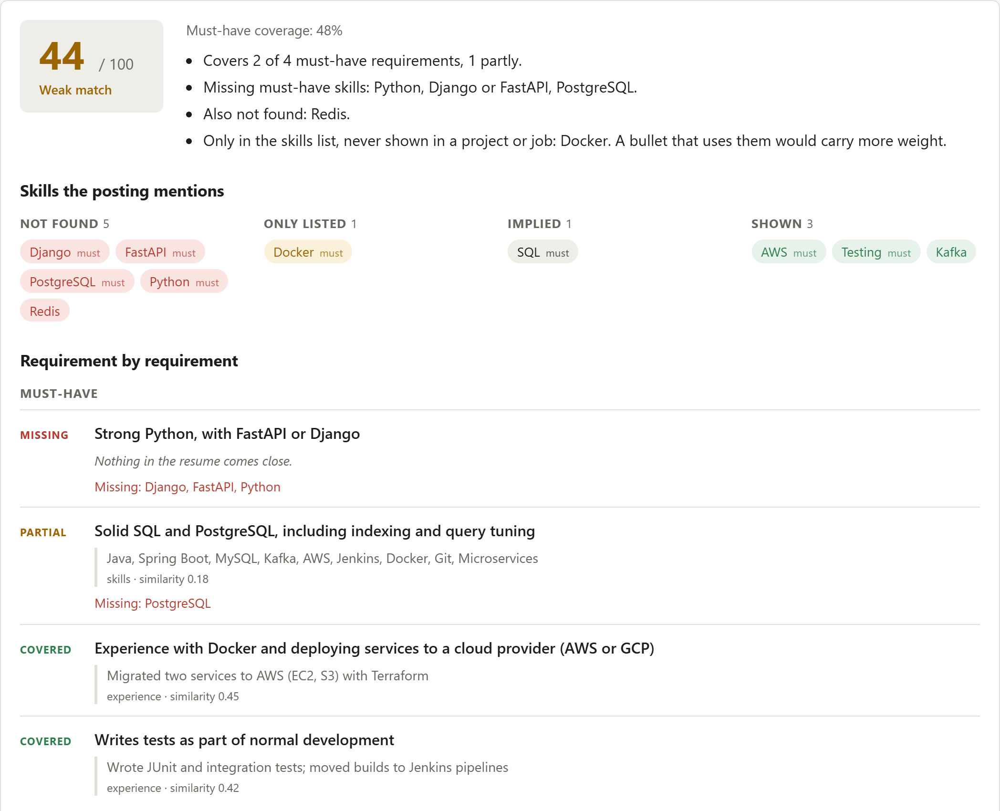

# ResuMatch

Paste a job description, upload a resume, and get a breakdown of which
requirements the resume actually covers, which skills are missing, and which
ones are only sitting in the skills list without any project or job to back
them up.

It also ranks a batch of resumes against one JD, for when you're on the other
side of the table.



Real output for one of the eval pairs (a Java/Spring developer against a
Python backend posting):

```
44 / 100 · must-have coverage 48%

- Covers 2 of 4 must-have requirements, 1 partly.
- Missing must-have skills: Python, Django or FastAPI, PostgreSQL.
- Also not found: Redis.
- Only in the skills list, never shown in a project or job: Docker.

MUST  missing  Strong Python, with FastAPI or Django
MUST  partial  Solid SQL and PostgreSQL, including indexing and query tuning
               > Java, Spring Boot, MySQL, Kafka, AWS, Jenkins, Docker, ...     skills · 0.18
MUST  covered  Writes tests as part of normal development
               > Wrote JUnit and integration tests; moved builds to Jenkins ...  experience · 0.42
NICE  covered  Kafka or another message queue
               > Develop Spring Boot microservices for a retail banking ...      experience · 0.44
```

## Why not just embed both documents and take the cosine?

That's the usual approach and it's a reasonable baseline (it's in the eval
below). The problems with it:

- It gives one number with no reason attached. You can't tell *what* is missing.
- MiniLM truncates at 256 tokens (~190 words), so most of a resume is never read.
- It can't tell "has used Kubernetes" from "typed Kubernetes into a list".
- "FastAPI or Django" counts against you if you only know one of them.

ResuMatch works line by line instead.

## How it works

1. **Parse the resume** (PyMuPDF). Lines are grouped into sections
   (experience, projects, skills, ...) using common heading names. Lines that
   the PDF layout wrapped are stitched back together, hyphenated breaks
   included. Contact details and company/date rows are dropped.
2. **Parse the JD** into requirement lines. Headings decide the weight:
   must-have (1.0), responsibility (0.6), nice-to-have (0.35). Line-level cues
   like "is a plus" or "required" override the heading. About-us, benefits and
   similar blocks are skipped. "3+ years of experience" lines are reported but
   not scored, because years can't be read off a resume reliably.
3. **Extract skills** from both using a dictionary of 100 skills with aliases
   ([skills.yaml](backend/resumatch/data/skills.yaml)). Lowercase aliases match
   case-insensitively, capitalised ones exactly, so "React" isn't confused
   with "react quickly" and "Go" isn't found in "Go-kart". "X or Y" in a
   requirement is treated as either-one.
4. **Score each requirement.** It's compared with every resume line using
   `all-MiniLM-L6-v2` embeddings. If it names skills, skill presence is 70% of
   its coverage and similarity is 30%. A skill gets full credit if a project
   or experience line uses it, half if it's implied by a skill that is used
   (PyTorch in a project → Python), and 0.35 if it only appears in the skills
   list.
5. **Overall score** is the weighted average coverage, 0–100. Each requirement
   comes back with its best-matching resume line so you can see why.

No LLM is involved. The same input always gives the same output, and the
explanations come straight from the matching, so they can't be made up.

## Eval

5 JDs × 9 synthetic resumes, labelled 0/1/2. Details and caveats in
[eval/README.md](eval/README.md); the short version is that it's small and the
thresholds were tuned on it.

| method | nDCG@3 | pairwise acc | top-1 | keyword-stuffer rank (of 9, higher is better) |
|---|---|---|---|---|
| ResuMatch (MiniLM) | 0.910 | 0.849 | 5/5 | **5.2** |
| ResuMatch (hashing, no model) | 0.906 | 0.799 | 5/5 | 4.4 |
| whole-doc MiniLM cosine | 0.910 | **0.869** | 5/5 | 3.0 |
| whole-doc TF-IDF cosine | 0.869 | 0.844 | 5/5 | 2.2 |
| skill keyword overlap | 0.845 | 0.831 | 5/5 | 2.2 |

On ordering alone, ResuMatch is about level with whole-document cosine, a
little behind on pairwise accuracy. Where it does better is the
keyword-stuffed resume: the baselines put it 2nd or 3rd for most JDs,
ResuMatch puts it in the bottom half. And it explains every score, which the
baselines can't.

The first version did worse: 0.806 pairwise, with the stuffer at 2.2. Its
similarity thresholds were guesses (0.32/0.58, when unrelated lines actually
peak around 0.18) and a listed-only skill got 75% credit. Both were reset from
the similarity distribution in the eval data, which is why the numbers above
aren't held-out.

## Running it

Backend (Python 3.11+):

```bash
cd backend
pip install -r requirements-dev.txt
uvicorn resumatch.api:app --reload
```

Frontend:

```bash
cd frontend
npm install
npm run dev        # http://localhost:5173, proxies /api to :8000
```

Or the whole thing in one container:

```bash
docker build -t resumatch .
docker run -p 7860:7860 resumatch    # http://localhost:7860
```

The image runs MiniLM through ONNX (fastembed) instead of PyTorch. Same
embeddings to ~1e-7, but the server sits around 230 MB, so it fits Render's
free tier. `render.yaml` deploys it as is: New → Blueprint → pick the repo.
The free instance sleeps after 15 minutes idle, so the first request after
that takes 30-60 seconds.

Tests and eval:

```bash
cd backend && pytest                  # uses the hashing embedder, no download
python eval/run_eval.py               # from the repo root
```

Set `RESUMATCH_EMBEDDER=hashing` to run without downloading MiniLM.

## API

`POST /api/match` (multipart): `jd_text`, plus either `resume` (PDF) or `resume_text`.

`POST /api/rank` (multipart): `jd_text`, `resumes` (up to 25 PDFs). Files that
fail to parse come back with an `error` instead of breaking the batch.

`GET /api/health`

Uploads are limited to 5 MB and 6 pages. Nothing is written to disk.

## Limitations

- **Two-column resumes** can come out of the PDF in the wrong order. Single
  column works best.
- **Scanned PDFs** have no text layer and are rejected. There's no OCR.
- **Skills outside the dictionary** are invisible to the skill check and only
  count through similarity. Adding them to `skills.yaml` is a one-line change.
- **Years of experience** are not checked, only flagged.
- **English only.** Not tested on other languages.
- The score says how well a resume *covers what the JD asks for*. It isn't a
  hiring prediction and shouldn't be used as one.

## Layout

```
backend/resumatch/
  pdf.py         PDF -> text, with the usual failure cases
  resume.py      sections, wrapped lines, evidence lines
  jd.py          requirement lines and weights
  skills.py      alias matching, implied skills, "X or Y" groups
  embedding.py   MiniLM and a hashing fallback
  matcher.py     scoring and gap explanations
  api.py         FastAPI app, also serves the built frontend
frontend/        React + TypeScript + Vite
eval/            labelled data and the comparison script
```

MIT licensed.
